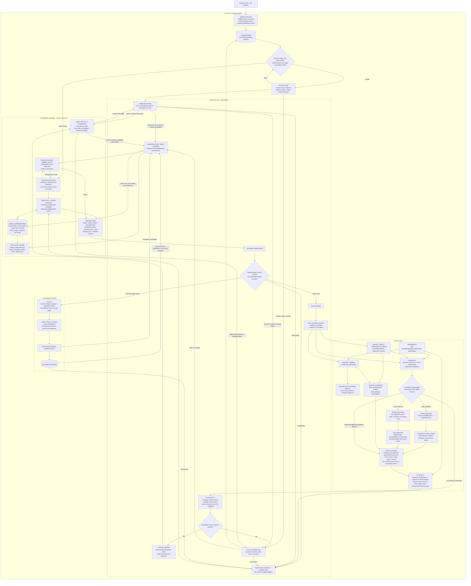

# Workflow UX and System Architecture

Implementation version 0.4.0. Seven focused webview views share three authoritative
backend stages. UI navigation is independent of persisted workflow readiness.
This document describes implemented behavior, not a remote-service architecture.

## Implemented review improvements

| Previous issue | Implemented solution |
|---|---|
| Whole-object JSON editing | Typed artifact forms, checklist reviews and ordered steps; read-only linkage/derived fields; advanced editable-field JSON |
| Long artifact lists | Searchable/filterable, 12-item paginated master-detail views |
| Successful saves discarded unrelated drafts | Keyed local drafts retained across actions/views/restoration; explicit rebase/discard; focus/scroll restoration |
| Generic downstream deletion warning | Exact host-computed remove/reset lists with paginated preview, cancel, backup-and-apply |
| Missing summary/recovery views | Export & Summary plus diagnostic recovery with raw backup/retry/confirmed reset |
| Large dashboard mixed future/current blockers | Compact score strip, current-stage blockers and expandable details |
| Enabled incomplete confirmation | Host-computed eligibility, disabled reasons, saved-state confirmation checks and linked field feedback |
| Duplicated clarification definitions | Shared specification supplies prompts, required keys and coverage checks |
| Navigation mutated saved stage | Seven-view presentation router; readiness derived from gates/artifact presence |
| IDs reused after regeneration | Generation revision protects drafts from accidental reuse; optional revision-qualified snapshot backup before destructive changes |
| Unchanged saves destroyed downstream work | Canonical editable-value comparison; no-op saves/confirmations; metadata-only edits preserve descendants |
| Broad Stage 2 invalidation | Content changes remove only affected feature/AC tests; Proceed fills missing categories/cases without replacing unrelated work |
| Repeated array scans and live full-text serialization | Indexed scoring/linkage validation, cached search text and 120 ms query debounce |
| Release checks were manual | CI, lint/type checks, browser host-bridge journeys, workload/package-content tests and real minimum/stable editor smoke tests |

Backups are immutable snapshots of the revision at capture time in user-selected
files, not a tamper-evident audit store, automatic undo or an import mechanism.

## Deliverable 1 - UI Flow Diagram

Blue nodes are working views. Orange nodes are error/blocked/impact states.
Diamonds represent host eligibility checks. Draft navigation never unlocks gates.

```mermaid
flowchart TB
  OPEN["Open Workflow command"] --> LOAD{"Saved workflow valid?"}
  LOAD -->|"No saved state"| BRIEF
  LOAD -->|"Valid: restore readiness + local view/drafts"| NAV
  LOAD -->|"Invalid: preserve raw state"| RECOVERY
  RECOVERY["Recovery view<br/>Diagnostic + Back up damaged snapshot<br/>Retry load / Reset saved workflow"] -->|"Retry"| LOAD
  RECOVERY -->|"Reset with native modal consent"| BRIEF

  subgraph STAGE1["Stage 1 - Product Definition"]
    BRIEF["Product Brief view<br/>Brief + optional intent URLs<br/>Analyze / Re-analyze; retained typed draft"] --> INPUT{"Brief and reference URLs valid?"}
    INPUT -->|"No: field / host error"| BRIEF
    INPUT -->|"Yes: local rules"| CLARIFY["Clarifications view<br/>Search / status / category / pages<br/>Questions, ambiguity flags, suggestions<br/>Answer + reviewer notes"]
    CLARIFY -->|"Resolve / Save"| ANSWERED["Saved answer; not yet confirmed"]
    ANSWERED --> ITEM{"Saved answer + notes populated<br/>and no unsaved item draft?"}
    ITEM -->|"No: Confirm disabled with reason"| CLARIFY
    ITEM -->|"Yes: Confirm saved resolution"| ALL{"All items confirmed?"}
    ALL -->|"No: keep product confirmation locked"| CLARIFY
    ALL -->|"Yes"| PRODUCT["Product review form<br/>Notes, priority, confidence<br/>Confirm product definition"]
    PRODUCT --> G1{"Gate 1: required items resolved + confirmed<br/>product metadata valid + confirmed?"}
    G1 -->|"No: Proceed disabled; list blockers"| CLARIFY
    G1 -->|"Yes: Proceed to Features"| GENF["Generate feature + initial AC drafts<br/>Persist candidate before publishing"]
  end

  GENF --> FEATURE
  subgraph STAGE2["Stage 2 - Feature and AC Review"]
    FEATURE["Features view<br/>Search/status/pages + one typed editor<br/>Scope, constraints, dependencies, INVEST<br/>Read-only IDs; Add AC; retained drafts"] <-->|"View navigation; no readiness mutation"| AC
    AC["Acceptance Criteria view<br/>Given / When / Then, exact measurement<br/>SMART + metadata<br/>Independent Resolve / Save"] --> ACCHECK{"Saved AC eligible and no local draft?"}
    ACCHECK -->|"No: Confirm disabled with reasons"| AC
    ACCHECK -->|"Yes: Confirm criterion"| FREADY{"All owned ACs validated/confirmed<br/>Feature metadata + INVEST valid?"}
    FREADY -->|"No: saved feature Confirm disabled"| FEATURE
    FREADY -->|"Yes: Confirm feature"| G2{"Gate 2: Gate 1 valid<br/>all features and ACs confirmed?"}
    G2 -->|"No: Proceed disabled"| FEATURE
    G2 -->|"Yes: Proceed to Scenarios"| GENT["Generate six scenarios per AC<br/>and initial cases in one transaction<br/>Persist before publishing"]
  end

  GENT --> SCENARIO
  subgraph STAGE3["Stage 3 - Scenario and Case Review"]
    SCENARIO["Test Scenarios view<br/>Search/status/category/pages<br/>Gherkin, technique, risk, typed GWT<br/>Resolve / Save; Confirm scenario; Add case"]
    SCENARIO <-->|"View navigation; drafts retained"| CASE["Test Cases view<br/>Preconditions, synthetic data, environment<br/>Ordered action / expected-result editor<br/>Add, remove, move steps; Resolve / Save"]
    SCENARIO --> SC{"Saved scenario eligible?"}
    SC -->|"No: Confirm disabled"| SCENARIO
    SC -->|"Yes: Confirm scenario"| TC{"Parent scenario confirmed<br/>Saved case metadata complete; no local draft?"}
    CASE --> TC
    TC -->|"No: Confirm test disabled with reasons"| CASE
    TC -->|"Yes: Confirm test"| G3{"Gate 3: prior gates valid<br/>Six categories per AC, cases present<br/>All tests complete and confirmed?"}
    G3 -->|"No: Complete review disabled"| CASE
    G3 -->|"Yes: Complete review"| SUMMARY
  end

  subgraph SHARED["Cross-view interactions"]
    NAV["Seven-view router<br/>Earlier views accessible<br/>Higher views require valid preceding gates + generated artifacts<br/>Selection, filters, focus and scroll retained"]
    STATUS["Compact metadata strip<br/>Readiness, revision, clarity, current-stage blockers<br/>One combined score + expandable stage counts"]
    SUMMARY["Export & Summary view - always accessible<br/>Counts, risks, readiness, stage gaps<br/>Retained / detached drafts; reference explorer"]
    REF["Searchable, paginated bidirectional explorer<br/>Product - Feature - AC - Scenario - Case<br/>Select ID to open its focused editor"]
    EXPORT["Select stage and JSON / YAML / Markdown<br/>Unsaved drafts excluded"]
    EREADY{"Selected export stage gate satisfied?"}
    FILE["Native Save dialog<br/>Draft/reviewed stage snapshot + all metadata<br/>Cancel leaves state unchanged"]
    CHANGE["Propose upstream edit or review change<br/>Compute validated candidate; saved state unchanged"]
    IMPACT{"Dependent removals / review resets?"}
    PREVIEW["Change impact dialog<br/>Exact ID lists + prior revision<br/>Cancel / Back up revision and apply / Apply without backup"]
    INVALIDATE["Apply: persist candidate<br/>Remove only content-dependent descendants / reset affected reviews<br/>Metadata-only changes retain descendant work<br/>Recalculate readiness, scores and both link directions<br/>Retain all other local drafts"]
    STALE["Saved fields or generation revision changed<br/>Save disabled until explicit rebase<br/>Inspect saved values / discard draft"]
    ERROR["Action/validation/persistence error<br/>Saved state unchanged; local drafts retained<br/>Field feedback + alert + eligible controls restored"]
  end

  NAV --> BRIEF
  NAV --> CLARIFY
  NAV --> FEATURE
  NAV --> AC
  NAV --> SCENARIO
  NAV --> CASE
  NAV --> SUMMARY
  BRIEF -.-> STATUS
  FEATURE -.-> STATUS
  SCENARIO -.-> STATUS
  STATUS -->|"Export & Summary"| SUMMARY
  SUMMARY --> REF
  REF --> NAV
  SUMMARY --> EXPORT
  EXPORT --> EREADY
  EREADY -->|"No: label DRAFT + blockers"| FILE
  EREADY -->|"Yes: label REVIEWED, not executed"| FILE
  BRIEF -->|"Re-analyze / revise"| CHANGE
  CLARIFY -->|"Change answers / reviews"| CHANGE
  FEATURE -->|"Edit / add AC / reviews"| CHANGE
  AC -->|"Edit / reviews"| CHANGE
  SCENARIO -->|"Edit with dependent cases"| CHANGE
  CHANGE --> IMPACT
  IMPACT -->|"None: save directly"| INVALIDATE
  IMPACT -->|"Disruptive"| PREVIEW
  PREVIEW -->|"Cancel: preserve edits"| NAV
  PREVIEW -->|"Backup cancelled: do not apply"| PREVIEW
  PREVIEW -->|"Apply; optional snapshot written first"| INVALIDATE
  INVALIDATE --> NAV
  INVALIDATE -->|"Other retained draft now stale"| STALE
  STALE -->|"Acknowledge rebase / discard only this draft"| NAV
  CHANGE -->|"Invalid candidate"| ERROR
  GENF -->|"Generation / persistence error"| ERROR
  GENT -->|"Generation / persistence error"| ERROR
  FILE -->|"Write error"| ERROR
  ERROR --> NAV

  classDef view fill:#e8f1ff,stroke:#2457a6,color:#172b4d
  classDef warning fill:#fff2df,stroke:#a65c00,color:#533000
  class BRIEF,CLARIFY,FEATURE,AC,SCENARIO,CASE,SUMMARY view
  class RECOVERY,PREVIEW,STALE,ERROR warning
```

## Deliverable 2 - System Architecture Flow Diagram

C4-inspired local component boundaries; generator nodes are logical
responsibilities, not separate services. Feature/AC and scenario/case drafts are
still generated together in their respective transactions.

The shared validation component serves both review-specific validators and
cumulative stage gates; the drawing does not imply every save must pass a
completed-stage gate. Structurally valid incomplete artifacts can be saved for
later review. Impact decisions are checked again against their originating
revision/token; cancelling a backup cannot apply an action.

## Traceability and metadata contract

- Product IDs/clarification IDs propagate to feature requirement IDs, AC IDs,
  scenario IDs and case IDs with validated parent relationships.
- Read-only `generation_revision` disambiguates regenerated drafts with reused
  stable IDs. Legacy snapshots without it remain supported.
- Forward references follow product -> feature -> AC -> scenario -> case.
  Reverse references follow the same edges in the opposite direction.
- Missing relationships/categories or incomplete reviews fail score checks.
  Scores are descriptive, not stage-gate permissions.
- Only committed snapshots determine eligibility, open counts, scores and exports.
  Local drafts do not claim reviewed coverage.
- Identical saves/confirmations preserve revision. Metadata-only edits retain
  descendants but still require upstream re-review before progression. Semantic
  feature/AC edits remove only dependent tests; generation fills missing coverage.
- Scores measure structural traceability and reviewed plans, not execution,
  semantic completeness or security assurance; UI and exports state this explicitly.
- Snapshot backup captures the prior full workflow revision; exports can be
  stage-specific and include upstream context only.

## Validation and remaining limits

Domain and mocked-host tests cover stage gates, navigation immutability, standalone
AC edits, exact impact lists, cancelled decisions, backup-before-apply,
persist-failure retry, malformed-state recovery, stale revisions, scoring and
stage-specific exports. Checked-in Chromium tests execute the actual compiled
host bridge with mocked editor APIs and cover gated launch, preserved drafts,
save failures, impact decisions, recovery, filters/pages, exports and review to
100%. Real editor smoke tests cover activation and webview lifecycle on the minimum
and current stable VS Code. Workload tests check 6,000 cases against explicit
calculation/edit budgets. Package tests exclude development tools from distribution.

The extension does not offer automatic history diffs, snapshot import/undo,
semantic ambiguity inference, test execution or standards certification. Draft
state is retained by the editor, not an independent durable audit store. A
manual installed-VSIX acceptance test remains recommended for native dialogs and
accessibility. CI cannot establish semantic correctness or standards certification.

## Source map

- [Lifecycle, request transactions and recovery](../src/extension.ts)
- [Typed domain contracts](../src/model.ts)
- [Shared clarification specification](../src/clarifications.ts)
- [Generation, review and readiness](../src/workflow.ts)
- [Runtime validation and stage gates](../src/validation.ts)
- [Eligibility and exact change impact](../src/presentation.ts)
- [Scoring and bidirectional references](../src/coverage.ts)
- [Snapshot exports](../src/export.ts)
- [Seven-view UI and local draft state](../media/main.js)
- [Layout and accessibility styling](../media/style.css)
- [Domain regression tests](../src/workflow.test.ts)
- [Mocked host transaction tests](../src/extension.test.ts)
- [Browser regression tests](../tests/ui/workflow.spec.js)
- [Real editor lifecycle smoke test](../tests/host/suite.cjs)
- [Workload regression budgets](../tests/scale.test.cjs)
- [Release verification CI](../.github/workflows/verify.yml)
